# Manual técnico — Proyecto 2 de Redes de Computadoras 2

**Autor:** Edin Rafael Santizo Barrera  
**Carné:** 202202072  
**Universidad:** Universidad de San Carlos de Guatemala  
**Simulador:** Cisco Packet Tracer 8.2.2.0400  
**Archivo base:** `Proyecto2_202202072.pkt`  
**Fecha:** 23 de octubre de 2026

Este documento describe la arquitectura, el direccionamiento, las configuraciones y las pruebas que realicé en Cisco Packet Tracer. Complementé las evidencias de funcionamiento con una captura de tráfico real obtenida mediante Wireshark/TShark en Ubuntu sobre WSL 2.

## 1. Descripción y objetivo

Diseñé una solución que interconecta los ISP **FibraNet GT**, **AndinaCom** y **MoonLink** mediante BGP, manteniendo un protocolo de enrutamiento interno adecuado a cada topología: OSPF en FibraNet y AndinaCom, y EIGRP en MoonLink. Incorpora servidores centrales DNS, HTTP/HTTPS y DHCP, HSRP para redundancia de capa 3, enlaces EtherChannel LACP, red inalámbrica en MoonLink y ACL extendidas para controlar las comunicaciones.

### Inventario extraído del archivo

| Elemento | Cantidad |
|---|---:|
| Routers Cisco 2911 | 15 |
| Switches Cisco 2960-24TT | 13 |
| Computadoras PC-PT | 14 |
| Laptop-PT | 1 |
| Servidores Server-PT | 2 |
| Router inalámbrico Linksys-WRT300N | 1 |
| Objetos de distribución de energía | 3 |
| Conexiones cableadas registradas | 52 |

Cada ISP tiene cinco routers. FibraNet y AndinaCom tienen cinco PC cada uno, y MoonLink cuatro PC más una laptop inalámbrica. Configuré seis parejas de switches que usan EtherChannel con `channel-group 1 mode active` (LACP).

## 2. Arquitectura de la topología

### 2.1 Interconexión BGP

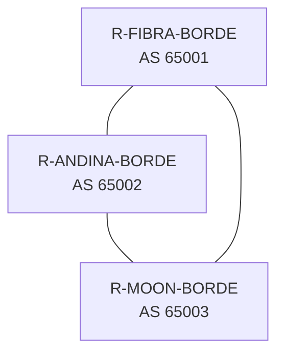

Los enlaces entre routers emplean direcciones de tránsito `192.168.72.0/16` subdivididas en redes `/30`; el archivo incorpora interfaces GigabitEthernet de los routers para la conexión física.

### 2.2 ISP FibraNet GT — Topología en árbol

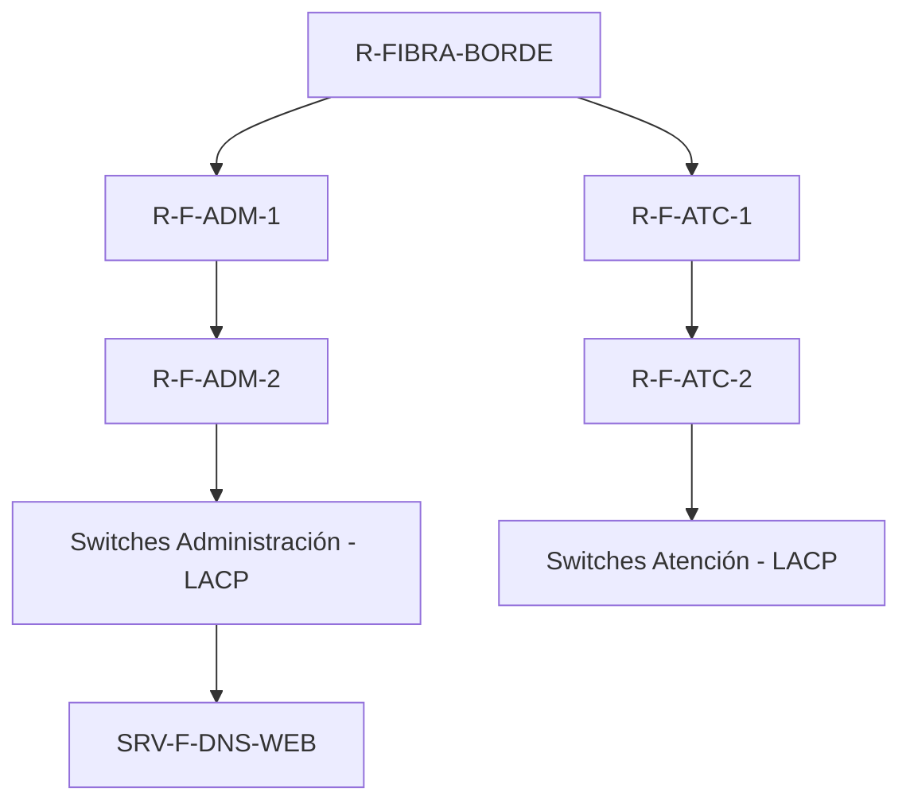

Protocolos: OSPF área 0 y dos agrupaciones LACP. Administración y Atención utilizan subredes `/25` para disponer de 126 hosts utilizables en cada segmento.

### 2.3 ISP AndinaCom — Modelo jerárquico con HSRP

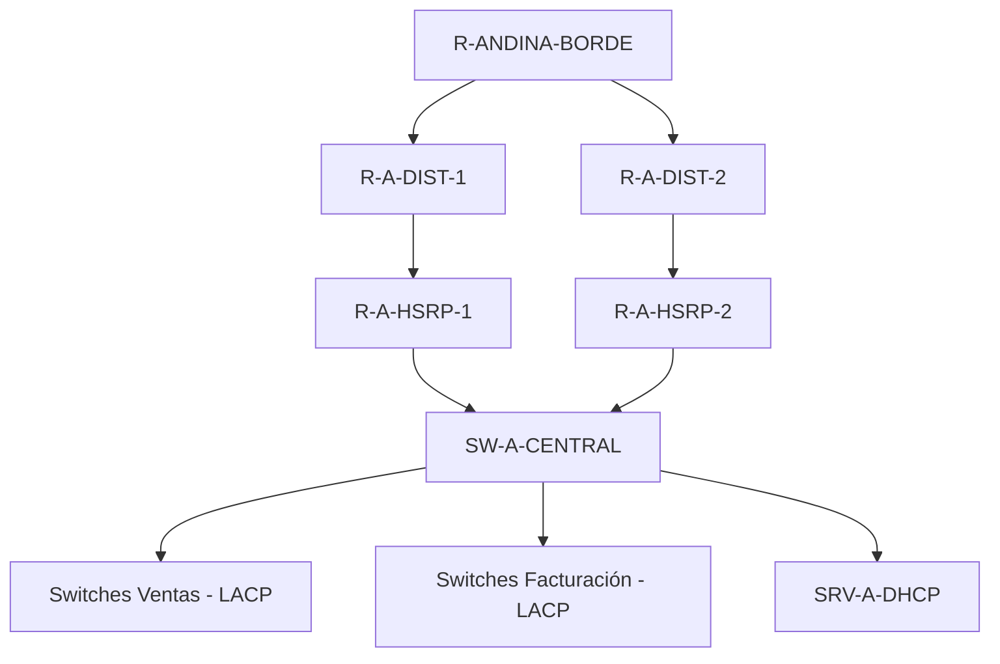

OSPF área 0, segmentación 802.1Q, redundancia HSRP y DHCP central. VLAN 10 para Ventas, 20 para Facturación y 30 para servicios.

### 2.4 ISP MoonLink — Hub-and-spoke

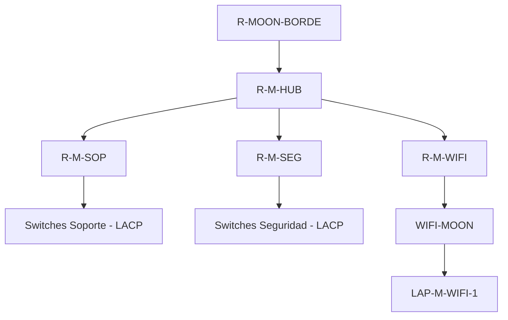

EIGRP AS 100, segmentos `/26` para departamentos (62 hosts utilizables cada uno), WiFi en red `/27`.

## 3. Subneteo y direccionamiento

| ISP | Departamento/segmento | Subred | Hosts utilizables | Gateway |
|---|---|---|---:|---|
| FibraNet | Administración | `172.16.12.0/25` | 126 | `172.16.12.1` |
| FibraNet | Atención al Cliente | `172.16.12.128/25` | 126 | `172.16.12.129` |
| AndinaCom | Ventas (VLAN 10) | `172.16.22.0/26` | 62 | `172.16.22.1` |
| AndinaCom | Facturación (VLAN 20) | `172.16.22.64/26` | 62 | `172.16.22.65` |
| AndinaCom | Servicios (VLAN 30) | `172.16.22.128/27` | 30 | `172.16.22.129` |
| MoonLink | Soporte | `172.16.32.0/26` | 62 | `172.16.32.1` |
| MoonLink | Seguridad | `172.16.32.64/26` | 62 | `172.16.32.65` |
| MoonLink | WiFi | `172.16.32.128/27` | 30 | `172.16.32.129` |

### 3.1 Direcciones de interfaces de routers

La siguiente tabla resume las direcciones configuradas en las interfaces de los routers.

| Router | Interfaz | Dirección IP | Máscara |
|---|---|---|---|
| R-FIBRA-BORDE | GigabitEthernet0/0/0 | `192.168.72.73` | `255.255.255.252` |
| R-FIBRA-BORDE | GigabitEthernet0/1/0 | `192.168.72.65` | `255.255.255.252` |
| R-FIBRA-BORDE | GigabitEthernet0/2/0 | `192.168.72.10` | `255.255.255.252` |
| R-FIBRA-BORDE | GigabitEthernet0/3/0 | `192.168.72.1` | `255.255.255.252` |
| R-ANDINA-BORDE | GigabitEthernet0/0/0 | `192.168.72.133` | `255.255.255.252` |
| R-ANDINA-BORDE | GigabitEthernet0/1/0 | `192.168.72.129` | `255.255.255.252` |
| R-ANDINA-BORDE | GigabitEthernet0/2/0 | `192.168.72.5` | `255.255.255.252` |
| R-ANDINA-BORDE | GigabitEthernet0/3/0 | `192.168.72.2` | `255.255.255.252` |
| R-MOON-BORDE | GigabitEthernet0/1/0 | `192.168.72.193` | `255.255.255.252` |
| R-MOON-BORDE | GigabitEthernet0/2/0 | `192.168.72.9` | `255.255.255.252` |
| R-MOON-BORDE | GigabitEthernet0/3/0 | `192.168.72.6` | `255.255.255.252` |
| R-F-ADM-2 | GigabitEthernet0/0 | `172.16.12.1` | `255.255.255.128` |
| R-F-ADM-2 | GigabitEthernet0/3/0 | `192.168.72.70` | `255.255.255.252` |
| R-F-ATC-1 | GigabitEthernet0/2/0 | `192.168.72.77` | `255.255.255.252` |
| R-F-ATC-1 | GigabitEthernet0/3/0 | `192.168.72.74` | `255.255.255.252` |
| R-F-ADM-1 | GigabitEthernet0/2/0 | `192.168.72.69` | `255.255.255.252` |
| R-F-ADM-1 | GigabitEthernet0/3/0 | `192.168.72.66` | `255.255.255.252` |
| R-F-ATC-2 | GigabitEthernet0/0 | `172.16.12.129` | `255.255.255.128` |
| R-F-ATC-2 | GigabitEthernet0/3/0 | `192.168.72.78` | `255.255.255.252` |
| R-A-DIST-1 | GigabitEthernet0/2/0 | `192.168.72.137` | `255.255.255.252` |
| R-A-DIST-1 | GigabitEthernet0/3/0 | `192.168.72.130` | `255.255.255.252` |
| R-A-DIST-2 | GigabitEthernet0/2/0 | `192.168.72.141` | `255.255.255.252` |
| R-A-DIST-2 | GigabitEthernet0/3/0 | `192.168.72.134` | `255.255.255.252` |
| R-A-HSRP-1 | GigabitEthernet0/0.10 | `172.16.22.2` | `255.255.255.192` |
| R-A-HSRP-1 | GigabitEthernet0/0.20 | `172.16.22.66` | `255.255.255.192` |
| R-A-HSRP-1 | GigabitEthernet0/0.30 | `172.16.22.130` | `255.255.255.224` |
| R-A-HSRP-1 | GigabitEthernet0/3/0 | `192.168.72.138` | `255.255.255.252` |
| R-A-HSRP-2 | GigabitEthernet0/0.10 | `172.16.22.3` | `255.255.255.192` |
| R-A-HSRP-2 | GigabitEthernet0/0.20 | `172.16.22.67` | `255.255.255.192` |
| R-A-HSRP-2 | GigabitEthernet0/0.30 | `172.16.22.131` | `255.255.255.224` |
| R-A-HSRP-2 | GigabitEthernet0/3/0 | `192.168.72.142` | `255.255.255.252` |
| R-M-HUB | GigabitEthernet0/0/0 | `192.168.72.205` | `255.255.255.252` |
| R-M-HUB | GigabitEthernet0/1/0 | `192.168.72.201` | `255.255.255.252` |
| R-M-HUB | GigabitEthernet0/2/0 | `192.168.72.197` | `255.255.255.252` |
| R-M-HUB | GigabitEthernet0/3/0 | `192.168.72.194` | `255.255.255.252` |
| R-M-SOP | GigabitEthernet0/0 | `172.16.32.1` | `255.255.255.192` |
| R-M-SOP | GigabitEthernet0/3/0 | `192.168.72.198` | `255.255.255.252` |
| R-M-SEG | GigabitEthernet0/0 | `172.16.32.65` | `255.255.255.192` |
| R-M-SEG | GigabitEthernet0/3/0 | `192.168.72.202` | `255.255.255.252` |
| R-M-WIFI | GigabitEthernet0/0 | `172.16.32.129` | `255.255.255.224` |
| R-M-WIFI | GigabitEthernet0/3/0 | `192.168.72.206` | `255.255.255.252` |

## 4. Enrutamiento

| ISP | Protocolo interno | Router principal | BGP |
|---|---|---|---|
| FibraNet GT | OSPF proceso 1, área 0 | `R-FIBRA-BORDE` | AS 65001 |
| AndinaCom | OSPF proceso 1, área 0 | `R-ANDINA-BORDE` | AS 65002 |
| MoonLink | EIGRP AS 100 | `R-MOON-BORDE` | AS 65003 |

Los tres routers de borde mantienen sesiones eBGP con sus dos vecinos. El borde de AndinaCom anuncia `172.16.22.0/24` mediante una ruta agregada a `Null0`; las rutas internas más específicas permiten alcanzar cada segmento correctamente.

**Comandos de consulta:**

```text
show ip bgp summary
show ip bgp
show ip ospf neighbor
show ip eigrp neighbors
show ip route
```

## 5. Alta disponibilidad y VLANs

| HSRP | VLAN | Dirección virtual | Router primario | Router secundario |
|---|---|---|---|---|
| Grupo 10 | Ventas | `172.16.22.1` | `172.16.22.2` | `172.16.22.3` |
| Grupo 20 | Facturación | `172.16.22.65` | `172.16.22.66` | `172.16.22.67` |
| Grupo 30 | Servicios | `172.16.22.129` | `172.16.22.130` | `172.16.22.131` |

`R-A-HSRP-1` utiliza prioridad 105 y preemption; el segundo router conserva la prioridad predeterminada. Ambos usan seguimiento del enlace ascendente (`GigabitEthernet0/3/0`). En mis pruebas, el segundo router asumió el estado Active durante la falla del enlace y el primario recuperó ese estado cuando lo restablecí.

Los enlaces agregados se implementan con **LACP activo**, utilizando dos enlaces físicos por pareja de switches. Se verifican con `show etherchannel summary`.

## 6. Servicios centrales

### 6.1 DNS y página web — FibraNet

- Servidor: `SRV-F-DNS-WEB`.
- IP estática del servidor: **172.16.12.10**, máscara **255.255.255.128**, gateway **172.16.12.1**.
- Registro DNS tipo A: `www.proyecto2_202202072.com` → `172.16.12.10`.
- Servicios HTTP y HTTPS: activados en el archivo.

### 6.2 DHCP centralizado — AndinaCom

- Servidor: `SRV-A-DHCP`.
- IP estática del servidor: **172.16.22.140**, máscara **255.255.255.224**, gateway **172.16.22.129**.
- Las interfaces de puerta de enlace de los clientes utilizan `ip helper-address 172.16.22.140`, cuando el servidor se ubica en una subred distinta.

| Grupo DHCP | Inicio | Máximo de clientes | Gateway | DNS |
|---|---|---:|---|---|
| ANDINA_VENTAS | `172.16.22.10` | 40 | `172.16.22.1` | `172.16.12.10` |
| ANDINA_FACTURACION | `172.16.22.74` | 40 | `172.16.22.65` | `172.16.12.10` |
| FIBRA_ATENCION | `172.16.12.140` | 100 | `172.16.12.129` | `172.16.12.10` |
| MOON_SOPORTE | `172.16.32.10` | 50 | `172.16.32.1` | `172.16.12.10` |
| MOON_SEGURIDAD | `172.16.32.74` | 50 | `172.16.32.65` | `172.16.12.10` |
| MOON_WIFI | `172.16.32.140` | 15 | `172.16.32.129` | `172.16.12.10` |
| FIBRA_ADMIN | `172.16.12.20` | 100 | `172.16.12.1` | `172.16.12.10` |

La asignación de los segmentos de usuarios se concentra en los siete grupos DHCP indicados en la tabla.

### 6.3 WiFi — MoonLink

- Router inalámbrico: `WIFI-MOON`, LAN `172.16.32.130/27`.
- SSID configurado: `MOONLINK_202202072`.
- DHCP local del router inalámbrico: desactivado.
- Clientes WiFi: direccionamiento mediante servidor DHCP centralizado.

## 7. ACLs extendidas y justificación

Las ACLs filtradas se ubican cerca del origen o de la red protegida para controlar el tráfico interdepartamental:

| ACL aplicada | Equipo | Interfaz de entrada | Función |
|---|---|---|---|
| `ACL_ATC_PROTO` | R-F-ATC-2 | Gi0/0 | Bloquea Atención→Facturación; permite ICMP y HTTP hacia Ventas y bloquea otros protocolos hacia esa red |
| `ACL_VENT_PROTO` | R-A-HSRP-1 y 2 | Gi0/0.10 | Permite ICMP y HTTP hacia Atención y Facturación, restringiendo otros protocolos hacia esas redes |
| `ACL_FACT_PROTO` | R-A-HSRP-1 y 2 | Gi0/0.20 | Bloquea Facturación→Atención; permite ICMP y HTTP hacia Ventas y restringe otros protocolos hacia Ventas |
| `ACL_SEG_PROTEGIDA` | R-M-SEG | Gi0/3/0 | Impide iniciar comunicaciones externas hacia Seguridad, permitiendo respuestas ICMP y TCP establecidas, además de respuestas DNS/DHCP específicas |

Utilicé reglas específicas para los segmentos restringidos y reglas finales de permiso para conservar otros servicios de red. La matriz de Simple PDU documenta el comportamiento ICMP; las reglas TCP/80 y TCP/443 se describen a partir de la configuración de las ACL.

## 8. Evidencia de conectividad

### 8.1 Matriz de Simple PDU — resultados de mis pruebas

| N.º | Origen | Destino | Esperado | Obtenido |
|---:|---|---|---|---|
| 1 | `PC-M-SEG-1` | `PC-A-VENT-2` | Permitido | Successful |
| 2 | `PC-A-VENT-2` | `PC-M-SEG-1` | Bloqueado | Failed |
| 3 | `PC-M-SOP-2` | `PC-F-ADM-1` | Permitido | Successful |
| 4 | `PC-F-ADM-1` | `PC-M-SOP-2` | Permitido | Successful |
| 5 | `PC-F-ATC-1` | `PC-A-VENT-2` | Permitido | Successful |
| 6 | `PC-A-VENT-2` | `PC-F-ATC-1` | Permitido | Successful |
| 7 | `PC-F-ATC-1` | `PC-A-FACT-1` | Bloqueado | Failed |
| 8 | `PC-A-FACT-1` | `PC-F-ATC-1` | Bloqueado | Failed |
| 9 | `PC-A-FACT-1` | `PC-A-VENT-2` | Permitido | Successful |
| 10 | `PC-A-VENT-2` | `PC-A-FACT-1` | Permitido | Successful |
| 11 | `PC-M-SOP-2` | `PC-A-VENT-2` | Permitido | Successful |
| 12 | `PC-M-SEG-1` | `PC-F-ATC-1` | Permitido | Successful |
| 13 | `PC-F-ATC-1` | `PC-M-SEG-1` | Bloqueado | Failed |

**Resultado:** las 13 pruebas ICMP cumplieron el comportamiento esperado (permitido o bloqueado).

### 8.2 Persistencia de la configuración

Guardé el archivo, cerré Packet Tracer y volví a abrir la simulación. Comprobé: 2 vecinos BGP en cada borde, 2 vecinos OSPF en cada borde correspondiente, 4 vecinos EIGRP en HUB, estados HSRP correctos, 6 PDU acertados, DHCP remoto operativo, DNS/HTTP/HTTPS funcionales y ruta hacia el servidor disponible. Registré 7 de 7 comprobaciones correctas.

### 8.3 Capturas del funcionamiento

Incluí **16 capturas originales**, tomadas durante la configuración y las pruebas. Están organizadas y descritas en [`Evidencias/INDICE_EVIDENCIAS.md`](Evidencias/INDICE_EVIDENCIAS.md). Las imágenes muestran la topología y los resultados de distintos momentos de mi trabajo.

**Arquitecturas de los tres ISP:**

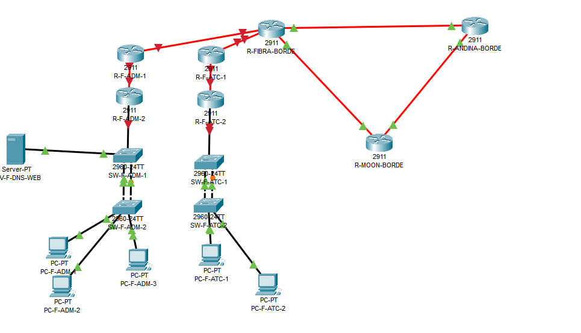

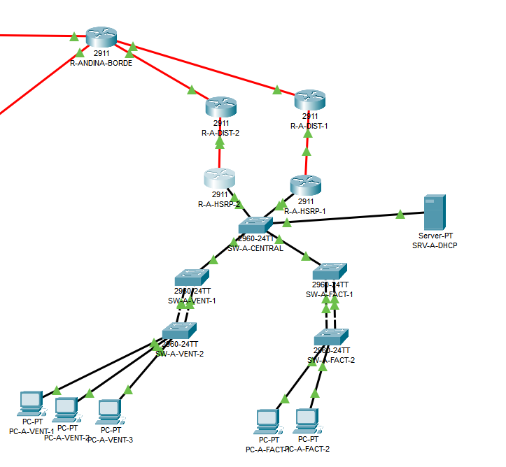

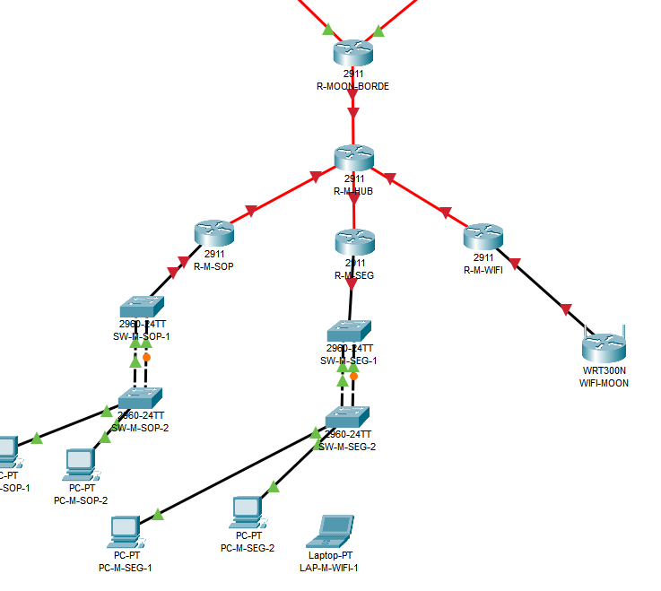

**Pruebas y configuraciones representativas:**

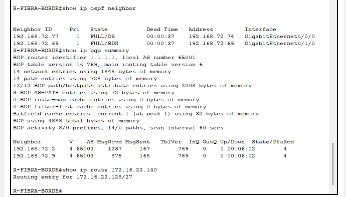

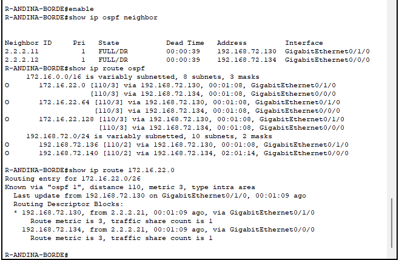

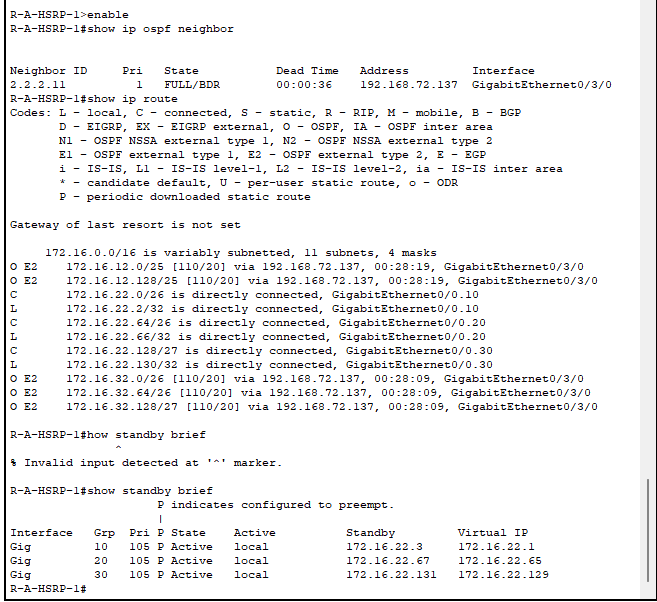

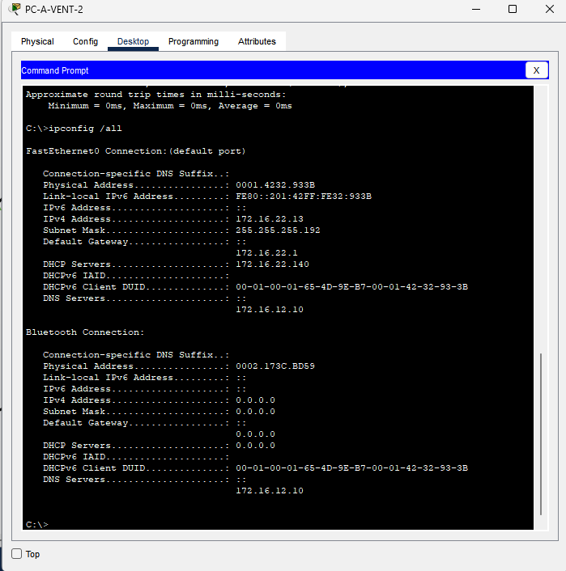

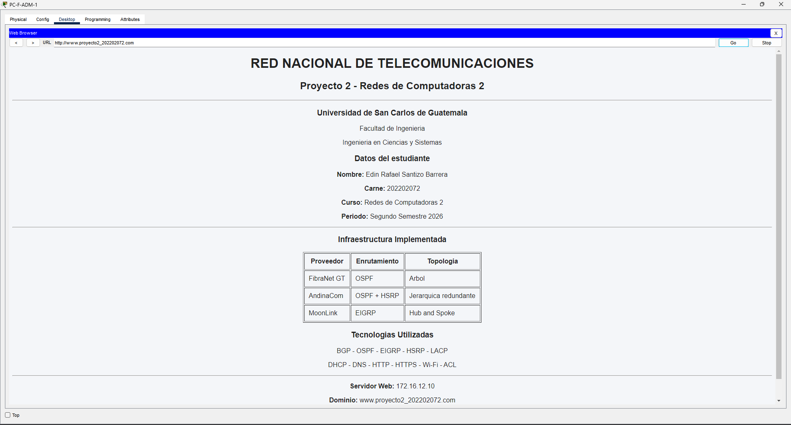

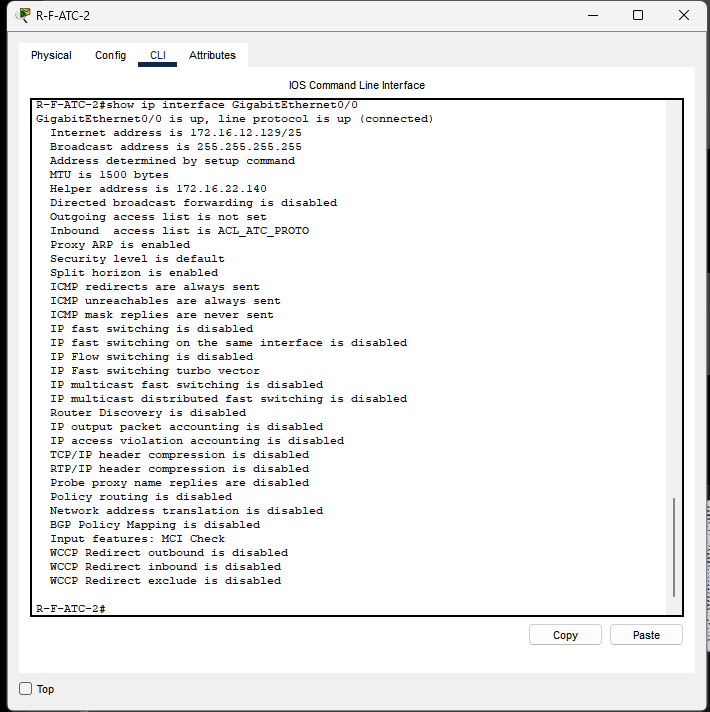

Las capturas ilustran las configuraciones, las asignaciones DHCP, los vecinos y el acceso web. Complementé estas imágenes con las pruebas de conectividad descritas en la matriz anterior.

## 9. Análisis de tráfico en Wireshark

Capturé el tráfico en `Wireshark/captura_wireshark_202202072.pcapng` desde **Ubuntu en WSL 2 sobre la interfaz `eth0`**. Analicé los paquetes que quedaron registrados en el archivo. Registra 39 tramas: 29 TCP, 2 UDP/DNS y 8 ICMP, con HTTP y TLS presentes dentro del tráfico TCP.

**Los cuatro escenarios de tráfico analizados son:**

| Escenario | Tramas verificadas | Observación |
|---|---|---|
| TCP three-way handshake | 3 SYN, 4 SYN-ACK, 5 ACK | TCP `172.31.15.97:52154 ↔ 172.66.147.243:80`, secuencias y ACK consistentes |
| DNS | 1 consulta, 2 respuesta | `example.com` registro A, UDP puerto 53, dos registros con TTL de 152 s |
| HTTP vs HTTPS/TLS | HTTP 6 y 8; TLS 16, 19, 24 y 26 | Petición `HEAD / HTTP/1.1`, respuesta `200 OK`; ClientHello/ServerHello TLS 1.3 y Application Data cifrada |
| ICMP | 29/30, 34/35, 36/37, 38/39 | Cuatro Echo Request y cuatro Echo Reply |

**Detalle capa por capa** (Ethernet, IPv4, TCP/UDP/ICMP y aplicación), identificadores DNS, TTL, números de secuencia TCP absolutos, puertos, banderas, comparación de cifrado y filtros exactos: consultar [`Wireshark/ANALISIS_CAPTURA.md`](Wireshark/ANALISIS_CAPTURA.md). Allí se incluye el análisis técnico de los **cuatro** escenarios, superando el mínimo de tres protocolos diferentes para el manual.

Realicé la captura en Ubuntu mediante WSL 2, modalidad autorizada por el auxiliar. Este tráfico real es distinto del tráfico virtual que se observa en Packet Tracer mediante Simulation.

## 10. Visualización de paquetes en modo Simulation

Para demostrar el recorrido de paquetes en Packet Tracer utilizo el modo **Simulation**. Desde **Edit Filters** selecciono DHCP, DNS, HTTP/HTTPS, OSPF, EIGRP o BGP; después genero un evento y utilizo **Capture/Forward** para recorrer la trayectoria. Esta función me permite consultar encabezados y dispositivos atravesados dentro de la infraestructura simulada, de forma complementaria al análisis real de Wireshark.

## 11. Archivo de simulación y configuraciones

Mi implementación fue realizada con **Cisco Packet Tracer 8.2.2.0400**. Organicé las configuraciones activas de los **15 routers** y **13 switches** en la carpeta `Configuraciones/`, una por dispositivo, para facilitar su consulta. Las ACL, los vecinos BGP, OSPF y EIGRP, los gateways HSRP y los enlaces LACP forman parte del proyecto `.pkt`.

El archivo guarda la topología, servidores y dispositivos finales necesarios para examinar los escenarios de conectividad. Los equipos finales utilizan DHCP y los servidores centrales tienen direcciones fijas.

## 12. Archivos del proyecto

```text
Proyecto_2/
├── Proyecto2_202202072.pkt
├── README.md
├── MANUAL_USUARIO.md
├── MANUAL_USUARIO.pdf
├── MANUAL_TECNICO.md
├── Proyecto2_Presentacion_202202072.pdf
├── Proyecto2_Presentacion_202202072.pptx
├── GUION_EXPOSICION.md
├── Configuraciones/       # configuraciones de routers y switches
├── Evidencias/            # fotografías del proyecto e índice
└── Wireshark/             # captura PCAPNG y análisis por capas
```

Presento los documentos en una estructura `Proyecto_2/` adecuada para su publicación en el repositorio de Redes de Computadoras 2. La presentación acompaña al manual, las capturas y el archivo de simulación.

**Edin Rafael Santizo Barrera — Carné 202202072**
